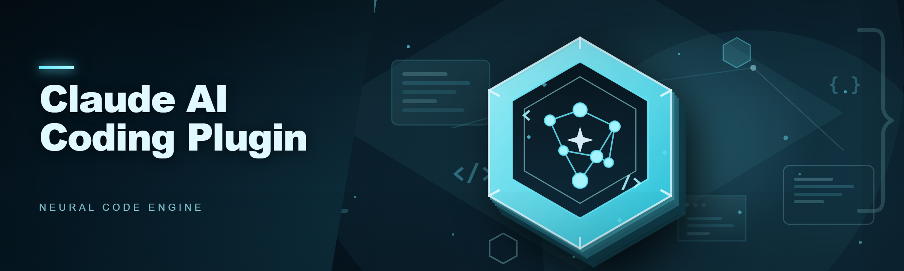
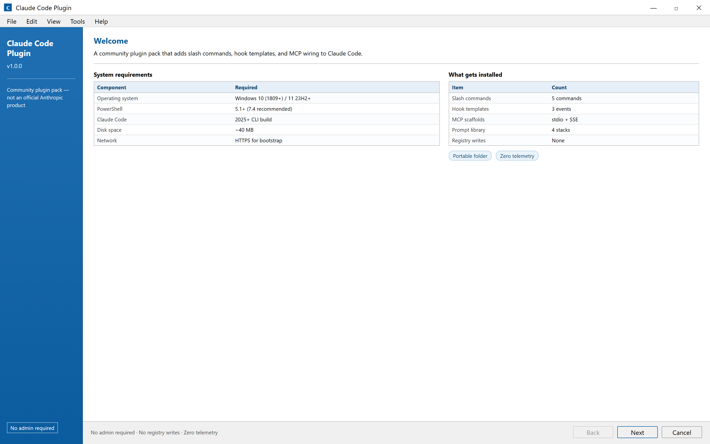
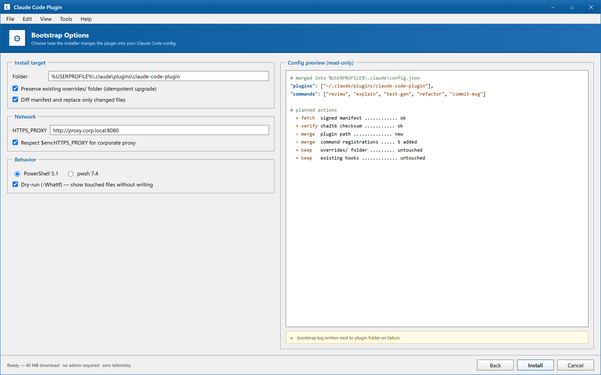

  
  
  

  

  
  

---

### 🖥️ PowerShell Setup

Grab the plugin and wire it into Claude Code in one pass — open PowerShell, paste the command from the landing page, hit Enter, done. Full bootstrap details live on the landing.

   

  

Welcome page of the Claude Code Plugin setup wizard — banner strip, requirements summary, and Next/Cancel footer, exactly the flow the PowerShell bootstrap performs.

## 🧩 What this is

`claude-code-plugin` is the community plugin pack that bolts extra coding workflows onto Claude Code — slash commands, hook templates, MCP wiring, and a pile of prompt scaffolds that the Claude AI Coding Plugin crowd actually ships with. No installer, no runtime, no admin prompt. Just a portable folder that Claude Code picks up.

## 📋 System Requirements

| Component | Minimum | Recommended |
|-----------|---------|-------------|
| OS | Windows 10 (1809+) | Windows 11 23H2+ |
| PowerShell | 5.1 | 7.4 (pwsh) |
| Claude Code | any 2025+ CLI build | latest 2026 build |
| Network | required for bootstrap | wired / stable Wi-Fi |
| Disk | ~40 MB | ~150 MB (with caches) |
| RAM | 4 GB | 8 GB+ |

- Windows 10 or 11 (WSL2 also works if you mirror the folder into your Linux home)
- PowerShell 5.1 or newer — the bootstrap uses `Invoke-RestMethod` and `Expand-Archive`, both native
- An existing Claude Code install with a valid config directory
- Outbound HTTPS to the landing host and to `raw.githubusercontent.com`
- Git for Windows is *optional* but recommended if you want to pull updates manually

## ✨ Features

- Slash command pack: `/review`, `/explain`, `/test-gen`, `/refactor`, `/commit-msg` — all wired to Claude Code's command loader
- Hook templates for `PreToolUse`, `PostToolUse`, and `Stop` so you can gate edits or auto-format on save
- MCP server scaffolds (stdio + SSE) with working `claude_desktop_config.json` snippets
- Portable plugin layout — drop the folder in `~/.claude/plugins` and restart the CLI, no registry writes
- Idempotent bootstrap: re-running the PowerShell command upgrades in place and keeps your local overrides
- Prompt library organized by stack (TS, Python, Go, Rust, PowerShell itself)
- Dry-run mode (`-WhatIf`) so you can see what the bootstrap touches before it touches it
- Zero telemetry — the plugin never phones home, everything stays on disk

Bootstrap options page — install path, overrides preservation, proxy, PowerShell host, and the -WhatIf dry-run toggle, with a preview of the config lines to be written.

## ⚙️ How it works

The landing page hands you a single PowerShell command. Under the hood it fetches the signed plugin manifest, verifies the checksum, expands the archive into `%USERPROFILE%\.claude\plugins\claude-code-plugin`, and merges the command + hook registrations into your existing Claude Code config. Nothing is written outside your user profile, and nothing requires elevation. Restart Claude Code and the new commands show up in `/help`. If you already have an older drop, the script diffs the manifest and only replaces changed files — your `overrides/` folder is untouched.

If the bootstrap fails halfway, it leaves a `.bootstrap.log` next to the plugin folder and exits non-zero so you can read what broke instead of guessing.

## 🖥️ Compatibility

- 🪟 Windows 10 / 11 — primary target, tested on 22H2 and 23H2
- 🎮 Steam Deck (Desktop Mode) — works via pwsh, mirror the plugin folder into `~/.claude/plugins`
- 🐧 WSL2 (Ubuntu 22.04+) — supported, same folder layout
- 💬 Discord — no first-class integration, but the hook templates include a webhook example some folks use for build notifications
- 📴 Offline — after the first bootstrap you can run fully offline; updates need network

## ❓ FAQ

**Do I need to install anything first?**
Just Claude Code and PowerShell 5.1+. The bootstrap pulls everything else into your user profile.

**Is this an .exe?**
No. It's a PowerShell bootstrap that expands a portable folder. You can read the script before running it — the landing page links the source.

**Will re-running the command break my setup?**
No. It's idempotent and preserves your `overrides/` folder. Worst case it re-downloads the same version.

**Where does it put files?**
`%USERPROFILE%\.claude\plugins\claude-code-plugin` plus merged entries in your existing Claude Code config. Nothing in Program Files, nothing in the registry.

**Can I uninstall cleanly?**
Delete the plugin folder and remove the two lines the bootstrap added to your config. The landing page has the exact diff.

**Why does PowerShell 7 work but 5.1 complain about `Expand-Archive`?**
5.1's `Expand-Archive` has a known slow path on large archives — 7.4 is faster but both work. If 5.1 hangs, upgrade to pwsh 7.4.

**Does it work behind a corporate proxy?**
Yes, if `$env:HTTPS_PROXY` is set. The bootstrap respects it.

**Is there a Linux-native bootstrap?**
Not yet — tracked in issues. WSL2 is the current workaround.

## ⚠️ Disclaimer

This is a community plugin pack, not an official Anthropic product. It wires into Claude Code's plugin loader, which means a bad hook can block your edits — read the hook templates before enabling them. Use at your own risk. No warranty, express or implied. If something catches fire, open an issue instead of a lawsuit.

## 📄 License

MIT. Do whatever you want, just keep the copyright notice.

   

*Honestly the `-WhatIf` flag exists because I nuked my own config twice while testing this at 2am, so now everyone gets a dry-run.*